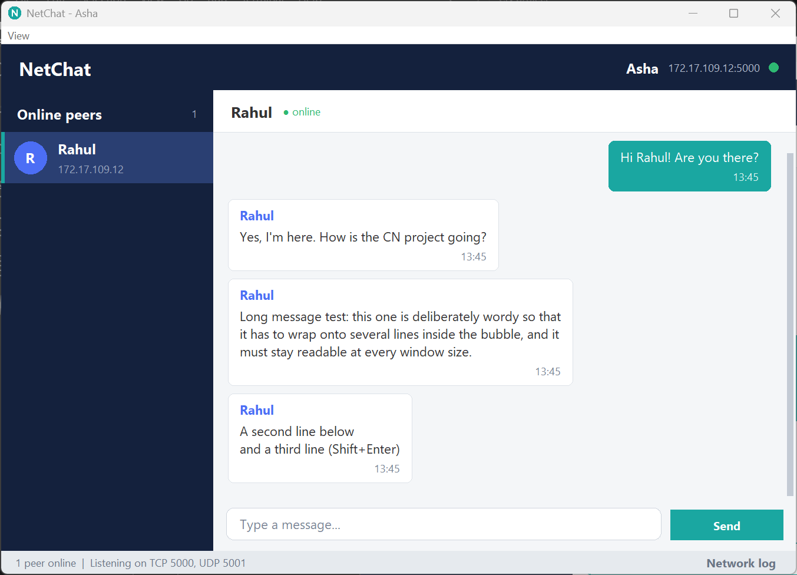
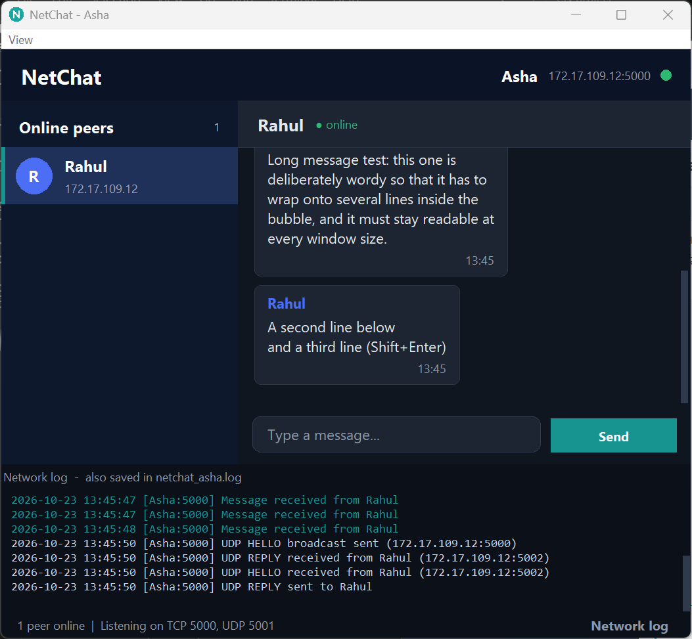
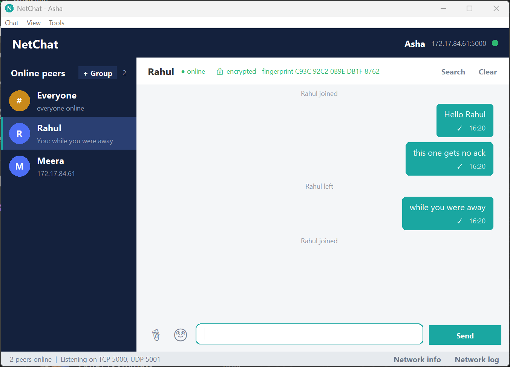
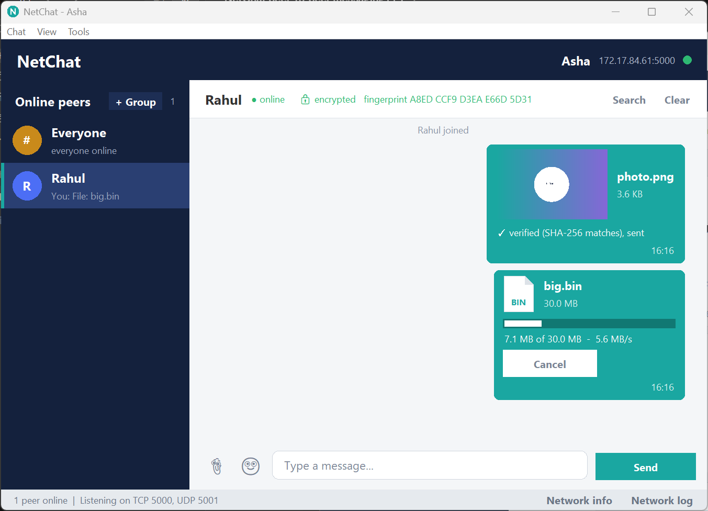
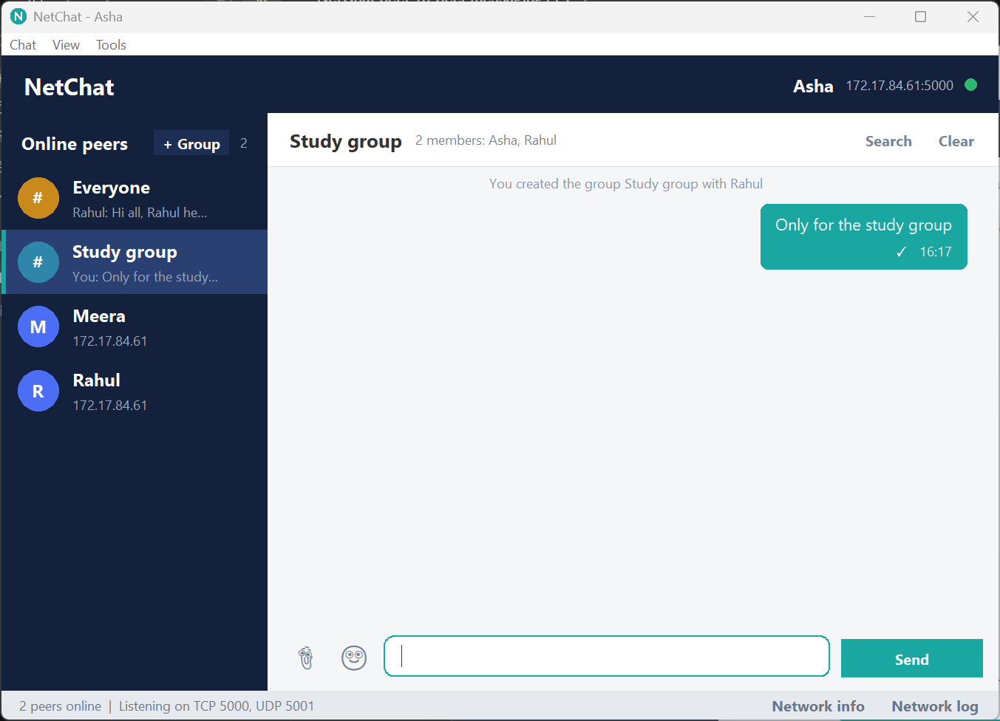
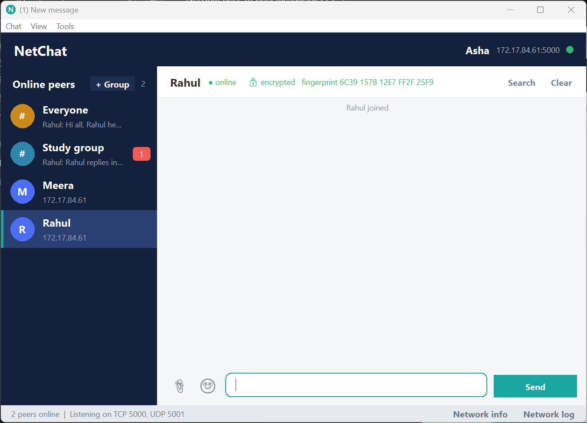
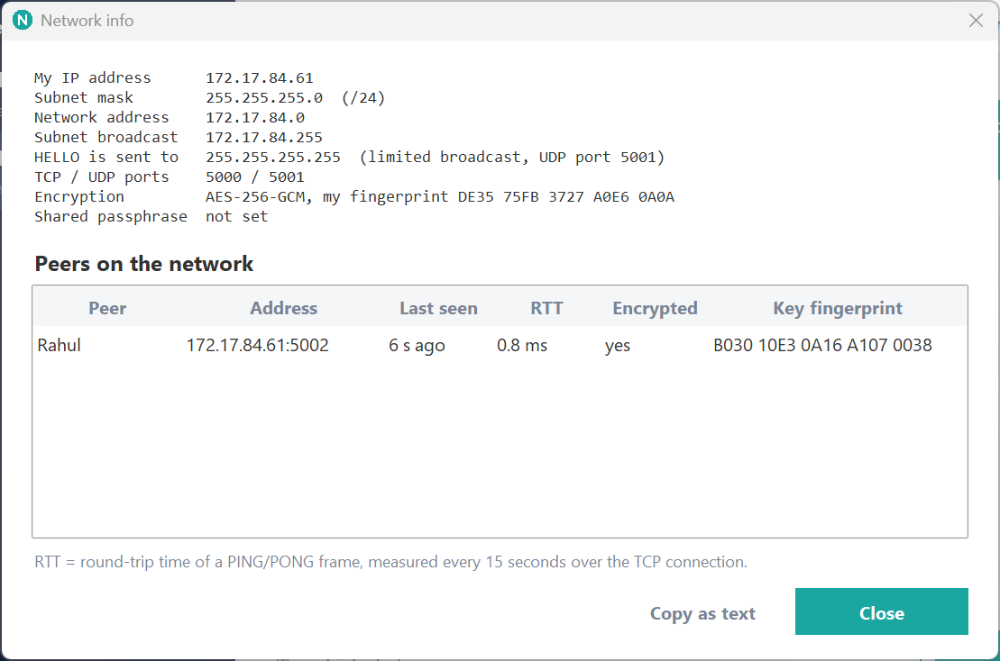

# NetChat - peer-to-peer LAN messenger

NetChat is a chat program for a Computer Networks project. People on the same LAN / Wi-Fi
talk **directly** to each other. There is **no central server**: every running copy is at the
same time

* a **TCP server** (others connect to it to send messages and files), and
* a **TCP client** (it connects to others).

Peers find each other automatically with **UDP broadcast**. Everything uses the Python
standard library (`socket`, `threading`, `sqlite3`, `tkinter`, `unittest`) **except encryption**,
which needs one optional package (`pip install cryptography`, see [Requirements](#requirements)).

## Features

| | Feature | Where to look |
|---|---|---|
| 1 | **Delivery receipts**: clock = sending, one tick = delivered, red "Failed - click to retry" | `peer.py` (`deliver`, ACK handling), `gui_chatview.py` |
| 2 | **Offline queue** (store and forward): messages for an offline peer wait, survive a restart, and go out in order when the peer's HELLO is seen again | `peer.py` (`flush_outbox`), `storage.py` (outbox table) |
| 3 | **Chat history** in `netchat.db` (sqlite), **search** in a chat, **clear chat** with confirmation | `storage.py`, `gui.py` |
| 4 | **Typing indicator** ("Rahul is typing...", at most one frame / 2 s, expires after 3 s) | `peer.py` (`send_typing`), `gui.py` |
| 5 | **Unread badges**, **last-message preview**, chats **sorted by recent activity** | `gui.py` (`_chat_entries`) |
| 6 | **File transfer** with Accept / Decline, 64 KB chunks, SHA-256 check, progress bar + speed, Cancel; files up to 100 GB are streamed (a 500 MB file used ~5 MB of extra memory) | `filetransfer.py` |
| 7 | **Attach button** (paperclip, Ctrl+O), PNG/GIF thumbnails, file icon otherwise, click a received file to open its folder | `gui_files.py`, `gui_chatview.py` |
| 9 | **Group chat**: the "Everyone" room and named groups with chosen members; a group appears on every member's computer from the first message | `gui_groups.py` |
| 10 | **Encryption** of all TCP traffic (X25519 + HKDF + AES-256-GCM, Ed25519 identity), lock icon, optional **shared passphrase** | `crypto.py`, `peer.py` |
| 11 | **Key fingerprint** next to the lock, to compare out loud | `gui.py` (`_update_chat_header`) |
| 12 | Copy a message (right-click), delete it locally, **emoji picker** (40 emojis) | `gui_chatview.py`, `gui_dialogs.py` |
| 13 | **Settings** dialog saved in `settings.json` (username, ports, download folder, sound, dark mode, passphrase) | `settings.py`, `gui_settings.py` |
| 14 | **Network info** panel: my IP, subnet, broadcast address, peers with last-seen time and **round-trip time** (PING/PONG every 15 s) | `netinfo.py`, `gui_dialogs.py` |
| 15 | **Resumable file transfers**: every chunk carries its SHA-256 (a damaged chunk is requested again); after a disconnection or a restart the transfer continues from the last whole chunk the receiver has (checked by hash), progress is saved in `netchat.db` | `filetransfer.py`, `storage.py` (transfers table) |
| 16 | **Automatic reconnection**: a dropped connection is rebuilt with bounded retries (0.5, 1, 2, 4, 8 s) | `peer.py` (`_reconnect`) |
| 17 | **Connect by IP** (Chat menu, `/connect IP[:PORT]`, `--peer IP[:PORT]`) when UDP discovery is blocked; the other side learns our port from the handshake | `peer.py` (`connect_to`) |
| - | **Console mode** (`--cli`): `/peers`, `/send`, `/file`, `/accept`, ... | `cli.py` |
| - | Network log panel (Ctrl+L), light / dark mode | `gui_status.py`, `gui_layout.py` |

Not included: drag-and-drop of files (Tk has no built-in support for it on Windows; use the
paperclip), and pasting an image from the clipboard (optional in the task, skipped).

## Screenshots

| | |
|---|---|
|  |  |
| *Chat between two peers (light mode)* | *Dark mode with the live network log (UDP discovery)* |
|  |  |
| *Delivery receipts and the offline queue* | *File transfer: SHA-256 verified file and a transfer in progress* |
|  |  |
| *Group chat* | *Encrypted connection with key fingerprint* |
|  | |
| *Network info: IP, subnet, broadcast, peers, RTT* | |

## Requirements

Windows 11 (or any OS), Python 3.10+ with tkinter (included in the normal python.org installer).

**Encryption is optional but recommended**: `pip install cryptography`. Without it NetChat
still works, but chats are NOT encrypted and the lock in the chat header is open. (TLS from
Python's `ssl` module would need certificates, and the standard library cannot create them, so
NetChat uses the `cryptography` package with X25519 + AES-GCM instead. See [Security](#security).)

## Architecture

```
main.py                 command-line options, settings.json, starts GUI or CLI

netchat/config.py       every port, timeout and limit in ONE place
netchat/protocol.py     UDP line format (discovery) + TCP frame format (length-prefixed JSON)
netchat/discovery.py    UDP broadcast, listener, heartbeat, peer table
netchat/connection.py   ONE TCP connection: send a frame, read a frame, optional encryption
netchat/crypto.py       identity keys, key exchange, AES-GCM records (optional dependency)
netchat/peer.py         TCP server, connections, handshake, ACKs, offline queue, typing, PING/PONG
netchat/filetransfer.py file offers, chunks, SHA-256, cancel
netchat/storage.py      sqlite3: history, outbox (offline queue), groups
netchat/settings.py     settings.json
netchat/netinfo.py      subnet / broadcast calculation

netchat/gui.py          the window: events, messages, sidebar        (uses these "mixins":)
netchat/gui_layout.py     building the window, light / dark themes
netchat/gui_status.py     status bar, network log panel, sound, blinking title
netchat/gui_files.py      file transfer in the window
netchat/gui_groups.py     group chats, fingerprint
netchat/gui_settings.py   settings, network info, emoji picker, restart
netchat/gui_chatview.py bubbles, file bubbles, the scrolling chat, sidebar rows
netchat/gui_dialogs.py  new group, settings, network info, emoji picker
netchat/gui_widgets.py  colours, fonts, input box, start-up dialog, icon
netchat/cli.py          console mode
netchat/logger.py       timestamped socket log (netchat.log)
tests/                  unittest tests (140)
```

Layers, from the network up. **Nothing in the network layer touches a widget, and nothing in the
GUI touches a socket**:

```
 GUI thread (tkinter)                         network threads
 +----------------------+   queue.Queue    +---------------------------------------------+
 | gui.py + mixins      | <--------------- | peer.py -> connection.py -> socket           |
 | root.after(100, ...) |  events only     |   |  \-> filetransfer.py   discovery.py (UDP)|
 | draws, asks user     | ---------------> |   \-> crypto.py (AES-GCM)                    |
 +----------+-----------+  method calls    +----------------------+----------------------+
            |   (deliver, accept_file ...)                        |
            +----------------- storage.py (sqlite, one lock) -----+
```

* **Threads.** one TCP-accept thread; one reader thread per connection; one UDP-listener and
  one heartbeat thread; one housekeeping thread (ACK time-outs, PINGs); short-lived threads for
  connecting, hashing and sending files. All are daemon threads and are joined on exit.
* **GUI rule.** Network threads only call `queue.put(...)`. The GUI thread empties the queue every
  100 ms in `_poll_events` (`gui.py`). Events are `message`, `msg_status`, `typing`, `secure`, `rtt`,
  `file_offer`, `file_state`, `file_progress`.
* **Every TCP connection works in both directions.** The side that dialed sends chat and files;
  the side that accepted answers on the *same* socket with ACKs, PONGs and accept / decline.

## How to run

### One computer, 2 or 3 instances

Every instance needs a **different TCP port**, the **same UDP port** (default 5001) and its **own
`--data-dir`** (otherwise they would share one history database and one `settings.json`):

```
python main.py --name Rahul --tcp-port 5000 --data-dir rahul
python main.py --name Asha  --tcp-port 5002 --data-dir asha
python main.py --name Meera --tcp-port 5003 --data-dir meera
```

### Two laptops

1. Connect both laptops to the **same Wi-Fi / hotspot** (see Troubleshooting for networks that block this).
2. Copy this folder to both (and `pip install cryptography` on both).
3. On each run `python main.py`. The default ports are fine because they are different computers.
   Give each person a different username: names identify peers.
4. Within a second or two each laptop appears in the other's peer list.

### Command-line options

| Option | Meaning |
|---|---|
| `--name NAME` | username (default: from `settings.json`, else a dialog asks) |
| `--tcp-port N` / `--udp-port N` | ports (defaults 5000 / 5001; the UDP port must be equal on all peers) |
| `--data-dir DIR` | folder for `netchat.db`, `settings.json`, `identity.key` (default: current folder) |
| `--download-dir DIR` | where received files go (default `Downloads\NetChat`) |
| `--passphrase TEXT` | shared room passphrase (visible in the process list; the Settings dialog is safer) |
| `--no-encryption` | switch encryption off (for the demo: show the open lock) |
| `--cli`, `--verbose` | console mode, also print the socket log |
| `--log-file FILE` | socket log (default `netchat.log`) |

A value comes from, in this order: command-line option, `settings.json`, default in `config.py`.

### Console mode

```
python main.py --cli --name Rahul --tcp-port 5000 --data-dir rahul
```

`/peers`, `/send NAME text`, `/file NAME path`, `/accept ID`, `/decline ID`, `/cancel ID`,
`/transfers`, `/to NAME` (then plain text goes to NAME), `/help`, `/quit`.
The offline queue works in console mode too.

### Keyboard

Enter sends, Shift+Enter new line, Esc clears the input, Ctrl+Up / Ctrl+Down switch chat,
Ctrl+F search, Ctrl+O send a file, Ctrl+L network log.

### Tests

```
python -m unittest discover -s tests -v
```

| File | What it checks |
|---|---|
| `test_protocol.py` | UDP lines; **every TCP frame type** round-trips; partial reads (1 byte at a time); glued frames; oversized header / chunk; bad JSON; wrong version; reserved names |
| `test_local_chat.py` | two real peers: discovery, BYE, delivery, connection reuse and reconnect, errors |
| `test_offline_queue.py` | ACK -> delivered; missing ACK -> failed -> retry; duplicates ignored; **queue delivers in order** and **survives a restart**; messages in flight when a connection breaks are re-sent; wrong version / garbage / oversized frames / no hello are dropped; no threads left after `stop()` |
| `test_file_transfer.py` | **10 MB random file arrives with the same SHA-256**; decline, cancel (both sides, partial file deleted); chat works during a transfer; wrong checksum detected; path traversal names; no overwrite; malicious chunks; connection loss |
| `test_crypto.py` | key agreement, tampered / replayed records fail, wrong passphrase, forged signature; with a **recording proxy**: text and file contents are not visible on the wire (and are visible with encryption off), a flipped bit is detected |
| `test_storage.py` | history order, search (incl. `%` and `_`), clear, previews, outbox order, groups, renaming the user |
| `test_misc_features.py` | settings file, command line vs settings priority, subnet maths, **RTT measurement**, changing the passphrase while running |
| `test_gui_widgets.py` | username validation, avatar colours, themes |
| `test_resume.py` | interrupted transfer **resumes from its offset**, **corrupted partial file** detected (starts again), **damaged chunk re-requested** / fails after 3, sender restart resumes from the database, cancel while interrupted; **reconnection** (rebuilt, bounded, not after BYE); **connect by IP** both ways, errors, kept alive by PONG |
| `test_security.py` | **duplicate names** in discovery, **signed / address-checked BYE** (forged and replayed BYEs ignored), **identity keys pinned on first use** (impostor and downgrade refused, user can trust a new key), per-recipient delivery order, ACK bookkeeping, cancel-vs-chunk race, GUI event loop survives errors and floods, bounded `stop()` |

## Protocol

### UDP: discovery (unchanged, plain text)

One datagram = one line, `TYPE|SENDER|TIMESTAMP|PAYLOAD\n`. Types: `HELLO` (broadcast, "I am here",
payload `ip:tcp_port`), `REPLY` (unicast answer), `BYE` (broadcast, "I am leaving"). `|`, newline,
carriage return and `\` in names are escaped (`\p`, `\n`, `\r`, `\\`).

### TCP: length-prefixed JSON frames

TCP is a byte stream with no message boundaries, and file data can contain any byte, so a text line
cannot be used. Every TCP message is a **frame**:

```
+---------------------+---------------------------+--------------------------+
| 4 bytes             | header_len bytes          | n bytes (only FILE_CHUNK)|
| header_len          | UTF-8 JSON object         | raw file data            |
| big-endian (struct) | {"v":1,"t":"MSG",...}     |                          |
+---------------------+---------------------------+--------------------------+
```

* `v` is the **protocol version** (now 1). A frame with another version is rejected cleanly: the
  other side gets an `ERROR` frame with code `version`, the connection is closed, the program goes on.
* `t` is the frame type. `n` (number of raw bytes after the header) exists only in `FILE_CHUNK`.
* The reader **loops until all bytes of a frame have arrived** (`protocol.read_exactly`), because
  one `recv()` may return only part of a frame or pieces of two frames.
* Limits, checked **before** reading the bytes: header <= 1 MB, chunk data <= 256 KB (we send 64 KB),
  chat text <= 1000 characters (sender), file offers <= 100 GB. Larger frames close the connection.

| Type | Direction | Fields | Meaning |
|---|---|---|---|
| `HI` | both, first frame | `name`, `pass` (bool), and when encrypting: `ident`, `eph`, `sig`, (`proof` in the answer) | handshake |
| `AUTH` | dialer -> listener | `proof` | key confirmation (plaintext MAC), then everything is encrypted |
| `MSG` | dialer -> listener | `id` (uuid4), `text`, `ts`, optional `group {id,name,members}` | chat message |
| `ACK` | reply | `id` | delivery receipt |
| `TYPING` | dialer -> listener | - | "is typing" (max 1 per 2 s) |
| `PING` / `PONG` | request / reply | `id`, `sent` | round-trip time |
| `FILE_OFFER` | sender -> receiver | `fid`, `name`, `size`, `sha256` | "I want to send this file" |
| `FILE_ACCEPT` / `FILE_DECLINE` | receiver -> sender | `fid` | the user's answer |
| `FILE_CHUNK` | sender -> receiver | `fid`, `seq`, `n` + raw bytes | up to 64 KB of data |
| `FILE_DONE` | sender -> receiver | `fid` | all chunks sent |
| `FILE_RESULT` | receiver -> sender | `fid`, `ok`, `reason` | size and SHA-256 checked |
| `FILE_CANCEL` | either | `fid` | stop |
| `ERROR` | either | `code`, `text` | fatal problem, connection closes |

All of this is documented field by field in `protocol.FRAME_TYPES`, and a test checks that every type
has a sample and a round trip.

### Message life cycle (ACK and offline queue)

```
deliver() writes the message into the OUTBOX (sqlite)
  |-- send OK ------> status "sending" (clock) --- ACK arrives ---> "delivered" (tick), outbox row deleted
  |                                          \--- no ACK in 10 s -> "failed" (red, click to retry)
  \-- connect/send fails -> status "queued" ("waiting for peer"), peer removed from the list
                                |
          peer's next HELLO seen (UDP) -> flush_outbox(): send queued messages oldest first
```

Because a message stays in the outbox until its ACK arrives, it survives a broken connection, a crash
and a restart (at-least-once delivery). A retry or re-send carries the **same id**, and the receiver
drops duplicates by id (and re-ACKs, because its first ACK may have been lost).

### File transfer

```
sender                                        receiver
  |-- FILE_OFFER (name, size, sha256) -------->|  user sees Accept / Decline
  |<------------- FILE_ACCEPT / FILE_DECLINE --|
  |-- FILE_CHUNK x N (64 KB) ----------------->|  written to disk while they arrive
  |-- FILE_DONE -------------------------------->|  size + SHA-256 checked
  |<------------------------ FILE_RESULT (ok) --|  both sides show "verified"
```

The file goes over the **same connection** as the chat. Each frame is sent under the connection's send
lock for that one frame only, so a chat message slips in between two chunks: chat is never blocked by a
transfer (a test sends a message in the middle of a 50 MB transfer and checks that its ACK arrives
while the file is still sending). The flow control is TCP's: if the receiver's disk is slow, its
socket buffer fills and `sendall()` waits.

## Security

**What is protected.** All TCP traffic between two NetChat programs: chat messages, group messages,
typing hints, PING/PONG and file contents, in both directions, with
**AES-256-GCM** (confidentiality *and* integrity: a changed or replayed record is detected and the
connection is dropped). The session keys come from an **X25519** key exchange with fresh keys for every
connection (so recorded traffic cannot be decrypted later), derived with **HKDF-SHA256**. NetChat uses
only these standard building blocks from the `cryptography` package and invents no cipher.

**Fingerprint.** Every user has a long-term **Ed25519** identity key (`identity.key` in the data
folder). The chat header shows the **fingerprint of the other person's key** (80 bits of its SHA-256).
Each key signs its handshake, so the fingerprint cannot be forged. Two people compare their
fingerprints **out loud** (Chat > My fingerprint). If they match, nobody is in the middle.

**Shared passphrase (optional).** If set (Settings), it is mixed into the key derivation. Two peers
with different passphrases derive different keys; the key confirmation step then fails and both
sides show a clear "passphrase mismatch". A peer without the passphrase cannot talk to you, and
plaintext connections are refused.

**What is NOT protected.**

* **UDP discovery is plaintext and unauthenticated.** Everybody on the LAN sees who is online (names,
  IP addresses, ports), and anybody can send a fake HELLO or BYE.
* **Without a passphrase, peers are not authenticated.** The handshake proves that the other side owns
  *some* key, not that it is *the person you think*. An attacker who relays your connection (a "man in
  the middle") would not be noticed, unless you compare fingerprints or use a passphrase.
* **Downgrade without a passphrase.** A peer without the `cryptography` package, or an attacker who
  deletes the key fields from the handshake, makes the connection fall back to plaintext. The lock is
  then open and red, but nothing stops you from typing. With a passphrase set, plaintext is refused.
* **Passphrase guessing.** Someone who can connect to you can test passphrase guesses against the key
  confirmation. Use a long one. It is stored **in plain text** in `settings.json`.
* **Metadata** (who talks to whom, when, how much) is visible on the network.
* **Data on disk is not encrypted**: `netchat.db` (history), downloaded files, `identity.key`,
  `settings.json`.
* Names are the identity: two users with the same name confuse each other.

## Windows Firewall

The first time you run NetChat, Windows asks *"Allow Python to communicate on these networks?"*.
Tick **Private networks** and click **Allow access**.

If you clicked Cancel or the popup never appeared:

1. Start menu -> **Windows Defender Firewall** -> *Allow an app or feature through Windows Defender Firewall*.
2. *Change settings* -> find **Python** (add `python.exe` with *Allow another app* if missing).
3. Tick **Private** (not Public) -> OK.

Or, as Administrator, allow the two ports:

```
netsh advfirewall firewall add rule name="NetChat TCP" dir=in action=allow protocol=TCP localport=5000
netsh advfirewall firewall add rule name="NetChat UDP" dir=in action=allow protocol=UDP localport=5001
```

Also make sure the Wi-Fi network is marked **Private**, not Public
(Settings -> Network & internet -> Wi-Fi -> your network -> Network profile type).

## Troubleshooting

* **Peers never show up.** Many college / office Wi-Fi networks use *client isolation* or block
  broadcast packets, so UDP discovery cannot work. Use a **mobile hotspot** (or a home router) for the
  demo. Open the network log (Ctrl+L): you should see `UDP HELLO received from ...` lines.
* **"Port already in use" / `WinError 10048`.** Another NetChat (or program) uses that TCP port.
  Choose another `--tcp-port`. Each instance on one PC needs its own.
* **Discovery works on one PC but not across laptops.** Firewall (see above) or different `--udp-port` values.
* **Status says "Broadcast failed".** The network refused the broadcast packet. Instances on the *same*
  computer still find each other (loopback fallback); for two laptops switch network.
* **A peer disappeared but is still listed.** It is removed on BYE, when a send to it fails, or after
  30 s without a heartbeat.
* **"passphrase mismatch" / red "Failed" on every message.** Both sides must use the same passphrase
  (or none). Check Tools > Settings on both.
* **Open lock / "not encrypted".** That peer (or you) does not have the `cryptography` package, or was
  started with `--no-encryption`.
* **Messages stay on "waiting for peer".** The peer is offline or its HELLO is not reaching you. They are
  delivered automatically when it appears (check the status bar: "N messages waiting to be delivered").
* **Two people with the same name.** Not supported.
* The socket log is in `netchat.log` (and in the network log panel).

## How the networking concepts appear in the code

| Concept | Where |
|---|---|
| **Socket**, **bind / listen / accept**, **connect** | `Peer.start()`, `_accept_loop()`, `_dial()` in `peer.py` |
| **TCP is a byte stream -> framing** | 4-byte length prefix + JSON, `protocol.read_frame`, `read_exactly` loops over partial reads |
| **Protocol versioning** | `"v"` in every frame; `VersionError` -> `ERROR` frame -> clean close |
| **Handshake** | `HI` exchange in `_serve_incoming` / `_dial` (names, capabilities, keys) |
| **Acknowledgements, reliability** | `MSG` -> `ACK`, `pending_acks`, 10 s time-out, retry with the same id, de-duplication |
| **Store and forward** | outbox table; `flush_outbox()` runs when a HELLO makes the peer reappear |
| **UDP broadcast + `SO_BROADCAST`, unicast reply, heartbeat / soft state** | `discovery.py` (HELLO every 10 s, peers silent for 30 s are dropped) |
| **Flow control, chunking** | 64 KB `FILE_CHUNK` frames, TCP window, `sendall()` blocking |
| **Integrity check** | SHA-256 of the whole file (`FILE_OFFER` / `FILE_RESULT`); AES-GCM tags per frame |
| **Encryption, key exchange, forward secrecy** | `crypto.py`: X25519, HKDF, AES-256-GCM, Ed25519 |
| **RTT measurement** | `PING` / `PONG` every 15 s, clock starts after the connection exists |
| **Multiplexing on one connection** | chat and file chunks share a connection; a per-connection send lock keeps frames whole |
| **Threads, locks, timeouts** | reader thread per connection; `Peer.conn_lock`, `state_lock`, `Connection.send_lock`, `Database.lock`; `select()` with a 1 s wake-up; `SEND_TIMEOUT`, `HANDSHAKE_TIMEOUT`, `ACK_TIMEOUT` in `config.py` |
| **Subnet, broadcast address** | `netinfo.py` (mask from the network card, `ipaddress` module) |

### Design notes

* **Same-PC testing on Windows.** With `SO_REUSEADDR`, a *broadcast* reaches every instance sharing the
  UDP port, but a *unicast* packet is delivered to only one of them. So when a HELLO arrives from a peer
  we did not know, we also broadcast our own HELLO once. This also makes discovery robust against lost
  UDP packets.
* **TCP resets can lose data.** Closing a socket that still has unread incoming data makes Windows send a
  RST, which throws away data the other side has not read yet. That is why messages are only removed from
  the outbox when their ACK arrives, and why a connection that dies with unacknowledged messages
  re-queues them immediately.
* **Why every connection is two-way.** ACKs, PONGs and file accept / decline need a way back. Replying on the
  same socket needs no extra connection and no knowledge of the other side's address.

## 5-minute demo script

Use two laptops on a hotspot, or two windows on one PC (start them as shown above, each with its own
`--data-dir`). Call the people **Rahul** (left laptop) and **Asha** (right laptop). Optional third window: **Meera**.

| Time | Do this | Say this |
|---|---|---|
| 0:00 | Start both programs. Wait two seconds. Point at the sidebar and the status bar ("1 peer online | Listening on TCP ..., UDP ..."). | "No server. Each program broadcast a UDP HELLO; the other answered with a REPLY. That is how they found each other." |
| 0:30 | **Tools > Network info.** Show IP, subnet mask, broadcast address and the table with **RTT** and fingerprint. Click *Copy as text* (paste it into your report later). Close it. | "This is the subnet and the broadcast address HELLO goes to. RTT is a PING/PONG frame every 15 seconds." |
| 1:00 | Rahul selects Asha and sends "Hello". Watch the clock turn into a tick. Asha starts typing: Rahul sees "Asha is typing...". | "The tick is a delivery receipt: Asha's program sent an ACK frame with the message id." |
| 1:30 | Press **Ctrl+L** (network log). Send a message. Point at the log lines (`HELLO`, `TCP connected`, `Message sent`). Close it. | "Every socket event is logged with a timestamp. This is the evidence for the report." |
| 2:00 | **Offline queue.** Close Asha's window. Rahul sends two messages: both show "waiting for peer"; the status bar says 2 messages waiting. Start Asha again. | "Store and forward. The messages were in a database on disk. When Asha's HELLO is seen again, they are delivered in order and the ticks appear." |
| 2:45 | **File.** Rahul clicks the paperclip, picks a picture (or a big file). Asha clicks **Accept**. Show progress bar and speed. While it runs, send a chat message. | "64 KB chunks over the same TCP connection; chat is not blocked. At the end both sides compare SHA-256 and show *verified*." |
| 3:30 | **Encryption.** Point at the lock and fingerprint in Asha's header. Rahul: Chat > My fingerprint. Read it out loud and compare. | "AES-GCM on every frame, keys from an X25519 exchange. The fingerprint proves nobody is in the middle; we compare it by voice." |
| 3:50 | Optional: start a third copy with `--no-encryption` (open red lock) or with a different passphrase (messages turn red with "passphrase mismatch"). | "Without the shared passphrase the other side is refused." |
| 4:15 | **Group.** Click **+ Group**, name it, tick Asha (and Meera). Send a message. The group appears on Asha's side by itself. Show the **Everyone** room. | "Each message carries the group id and members, so a computer that never heard of the group creates it." |
| 4:45 | Close Rahul, start him again: the history is there. **Tools > Settings**: switch on dark mode. Show `python -m unittest discover -s tests` passing. | "History is in sqlite; settings in settings.json; 105 automated tests." |

## Known limitations

* No drag-and-drop of files, no pasting of images (see Features).
* Files go to one person at a time (not to groups).
* Group membership is fixed when the group is created.
* A user who changes their username in Settings keeps their history (it is moved to the new name), but other
  people see them as a new peer and keep their chats under the old name.
* The "Everyone" room reaches the people who are online *at that moment*; it is not queued for offline peers
  (named groups are).
* The username must be unique on the network.
